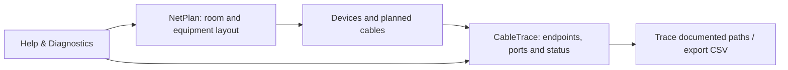

# NODEPLAN

### Plan the space. Trace the connections.

**NODEPLAN** is a responsive, browser-based workspace for designing physical network layouts and documenting cable connections. It brings room planning, network equipment placement, cable tracing, and basic troubleshooting guidance into one interface.

**NetPlan** uses red accents for spatial planning, **CableTrace** uses blue for cable documentation, and **Help & Diagnostics** uses green for support tools. The same HTML app adapts to desktop and mobile screens.

> **Project status:** Working prototype / portfolio project. Designed for planning and documentation, not live network discovery, electrical engineering validation, or production network monitoring.

## Try it

**[Launch NODEPLAN](https://sefkogg.github.io/NODEPLAN/)**

Or download `index.html` and open it in Google Chrome. No local build process is required. The 3D view loads Three.js from a CDN, so it may need an internet connection.

## Why I built it

I wanted a more visual way to work through the physical side of networking: where equipment sits in a room, how workstations and devices connect, and which cable leads to which endpoint. Instead of separating a floor-plan editor from a cable spreadsheet, NODEPLAN combines both workflows into a single application.

I started with the layout-planning experience, then iterated on object placement, camera navigation, equipment options, the interface, and the CableTrace workspace. Later revisions added a support area and responsive phone layouts. This project represents an iterative design-and-development process informed by hands-on testing and usability feedback.

## Features and what they do

| Feature | Purpose |
| --- | --- |
| **NetPlan (red)** | Design room layouts and place network/office equipment in a visual workspace. |
| **2D editor** | Arrange rooms, desks, computers, network devices, and other objects on a floor plan. |
| **3D view** | Inspect a spatial representation of the design and navigate around it. |
| **Equipment library** | Add available devices, furniture, outlets, windows, and other planning elements. |
| **Selection and inspector controls** | Choose objects and adjust supported properties such as position, size, or equipment options. |
| **Cable connections** | Represent physical connections between devices in the planning workspace. |
| **CableTrace (blue)** | Document cable IDs, endpoints, ports, cable types, status, and notes. |
| **Cable register** | Search and review documented cable connections in a structured list. |
| **Route tracing** | Find a route between two devices through *documented* connections; it does not scan a live network. |
| **CSV export** | Download cable records for sharing or further analysis. |
| **Help & Diagnostics (green)** | Run basic in-browser checks, read troubleshooting guidance, and prepare issue reports. |
| **Issue report** | Copy or download diagnostic details; reports are **not automatically submitted**. |
| **Responsive layout** | Reorganize the same workspaces for smaller screens while keeping desktop-oriented editing tools. |
| **Local project data** | Work with project data stored in the browser and use available import/export controls for backups. |

## How the workspaces fit together



## How I built it

- **HTML** for the application structure and its three workspaces.
- **CSS** for the dark dashboard, responsive layout, and workspace-specific red/blue/green themes.
- **Vanilla JavaScript** for object interactions, navigation, tab switching, forms, project state, and exports.
- **Three.js** (loaded via CDN) for the 3D view.
- **Browser storage** for local data persistence.
- **Mermaid** in this README for architecture documentation.

The application is distributed as a single `index.html` file. It does not require Node.js, npm, or a backend to run locally.

## Design and development process

1. **Define the workflow:** focus on physical network planning rather than abstract network diagrams alone.
2. **Build the editor:** create room and equipment placement tools and 2D/3D viewing options.
3. **Improve usability:** refine pan/zoom controls, selections, equipment sizing, and dashboard navigation.
4. **Add cable documentation:** introduce CableTrace for endpoint/port records, route lookups, and CSV export.
5. **Unify the interface:** use one recognizable logo with color-coded workspaces.
6. **Adapt to mobile:** rearrange controls and navigation for phone-sized screens without maintaining a separate application.
7. **Add support tools:** include troubleshooting guidance, diagnostics, and local issue-report generation.

## Running locally

1. Download or clone this repository.
2. Open `index.html` in a modern browser such as Chrome.
3. Select **NetPlan**, **CableTrace**, or **Help** from the top navigation.
4. Create a small example layout, connect devices, then inspect the documentation in CableTrace.

The browser version is available through the live demo link above.

## Example use cases

- Sketching a small office or home network before installation.
- Documenting which switch port connects to a particular workstation.
- Keeping a cable register for a small IT environment.
- Explaining physical topology to teammates or interviewers.
- Demonstrating front-end development, UI design, and networking knowledge.

## Limitations

- This is a **planning and documentation tool**, not a live network scanner.
- It does not automatically detect cables, devices, or switch configurations.
- Data saved in one browser does **not automatically sync** to another device.
- 3D rendering depends on browser support and access to the external Three.js CDN.
- Touch interactions and individual browser features can vary by device.
- Diagnostics check local browser/application capabilities; they do not diagnose a real network connection.

## Repository structure

```text
NODEPLAN/
├── index.html                 # Complete browser application
├── README.md                  # Project overview and feature guide
├── LICENSE                    # License notice included with the app
├── .gitignore
└── docs/
    ├── FEATURE-GUIDE.md       # What each workspace and tool does
```

## License and credits

The app includes an MIT license notice for original application code; third-party code and artwork retain their own applicable rights. The 3D workspace uses **Three.js 0.152.2**, which is MIT-licensed. See `LICENSE` and the in-app **License & Credits** panel. Third-party assets retain their respective licenses and attribution requirements.

---

**Portfolio focus:** Front-end development · Network infrastructure concepts · Physical topology documentation · Responsive UI/UX · Browser-based tooling
